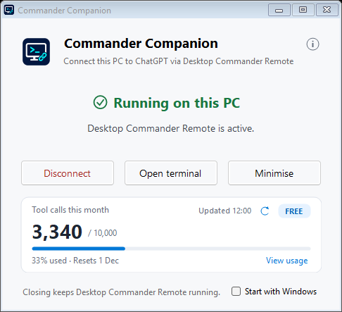
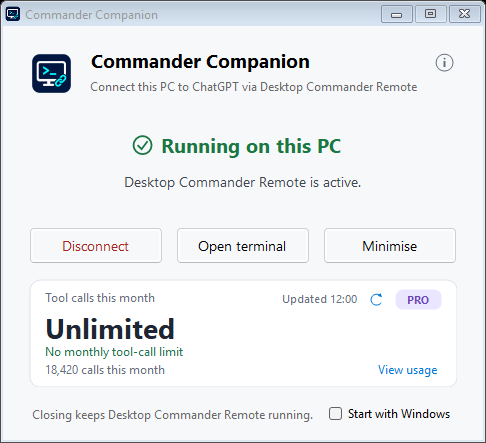
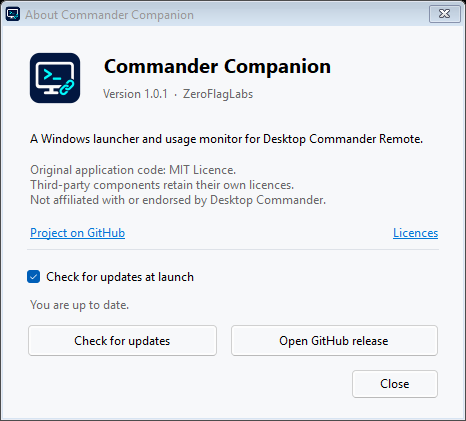

# Commander Companion

**Keep your Desktop Commander Remote connection and monthly tool-call usage in view.**

A small Windows launcher and usage monitor by **ZeroFlagLabs**. See exact monthly tool calls, your Free allowance and reset date, or **Unlimited** for Pro, alongside connection controls and a terminal viewer.

This is an independent, unofficial companion for [Desktop Commander Remote](https://desktopcommander.app/). It is not affiliated with or endorsed by Desktop Commander.

## Download and run

Download **[CommanderCompanion.exe](https://github.com/ZeroFlagLabs/commander-companion/releases/latest/download/CommanderCompanion.exe)** from the [latest release](https://github.com/ZeroFlagLabs/commander-companion/releases/latest), save it somewhere permanent, and run it.

**One EXE. No ZIP to extract, installer, DLL collection or companion script to download.** The release page includes its SHA-256 checksum. GitHub's automatic source-code downloads are for developers; you only need the EXE to use the app.

**Tested on Windows 11 x64.** Uses .NET Framework and the Evergreen WebView2 Runtime normally included with Windows 11. Internet access and your own Desktop Commander account are required for connection and live usage. If WebView2 has been removed from Windows, account usage is unavailable until that Windows component is restored; the connection controls remain separate.

This application is unsigned, so Windows may ask you to confirm running it. Commander Companion itself requests no administrator rights.

## Live monthly usage

The account panel is a central feature:

- **Free:** exact calls used, allowance, progress bar, percentage and the reset date returned by your account.
- **Pro:** **Unlimited**, plus the number of calls this month when supplied by the service.
- An **Updated** time and a background-free refresh arrow for an immediate check.
- Clear **signed-out**, **loading** and **temporarily unavailable** states. Missing information is never replaced with an invented count or allowance.
- **Sign in** opens the official account website in a dedicated window. **View usage** opens the usage page directly in your default browser.




*Screenshots use illustrative account figures. Pro reflects the service's plan; this utility does not change subscriptions or grant additional calls.*

Usage refreshes approximately every five minutes while the launcher is not minimised. Signed-out or unavailable states retry approximately every minute. The refresh arrow checks immediately. Usage checks never start, stop or reconnect the device agent.

## Getting connected

1. Open the EXE. An ordinary launch detects an existing agent and otherwise stays disconnected.
2. Click **Connect**. The embedded command invokes the official Desktop Commander Windows setup, which downloads the vendor's agent and can offer to install Node.js if required. These are the vendor's setup steps, not launcher files to collect.
3. Use **Open terminal** for setup progress, prompts and any device sign-in instructions. Its input box and **Send** button send a line to the console.
4. Click **Sign in** in the usage panel with the same Desktop Commander account. This separate account session enables the monthly usage display; it does not replace the device agent's sign-in.

Closing the launcher or terminal leaves Desktop Commander Remote running. **Disconnect** sends the equivalent of Ctrl+C to the identified agent console. The terminal preserves console colours and block lettering; long lines wrap, and scrolling up pauses display updates until you return to the bottom.

**Start with Windows** is optional. At Windows sign-in it connects automatically and starts minimised without taking focus. Save the EXE in a permanent location before enabling it. If you move it later, untick and re-tick the option to update its saved path.

Pin the EXE to your taskbar if wanted. The title bar supports minimise, with maximise disabled. Agents started outside this utility are also recognised. The status reports a running process on this PC, not a separate network connection test; inaccessible processes are left alone.

## About and updates

The **ⓘ** button opens version information, credits, readable embedded licence notices and GitHub updates. **Check for updates at launch** is a saved option, enabled initially. Checks read this project's small public `updates/latest.json` file without a GitHub login or the shared GitHub REST API allowance. **Open GitHub release** always opens the latest release page, including when a check fails or your version is current. Nothing is downloaded or installed automatically. The status-to-button and button-to-Close spacing stays equal even when a message wraps.



## Sign-in and internal files

The EXE bundles its managed libraries, native loaders, artwork, launch script and licence notices. It checks and unpacks the appropriate support files into a private cache under `%LOCALAPPDATA%\ZeroFlagLabs\CommanderCompanion\Runtime`. These are internal working files; nothing needs to be placed beside the EXE.

The official website owns account sign-in and cookies. The launcher does not read passwords, copy normal browser cookies, reuse the agent's saved token or send credentials to GitHub. The dedicated account profile is stored outside the project:

```text
%LOCALAPPDATA%\ZeroFlagLabs\RemoteDesktopCommanderLauncher\AccountBrowser
```

The profile's internal name is retained from development to preserve existing sign-ins. The vendor website may cache account data there. Your normal browser and the device agent have separate sessions. Sign out using the vendor's account menu in the account window if needed. No account profile, terminal log or personal account data is included in the source or release EXE.

The panel reads the same authenticated usage endpoint as the dashboard, within the vendor website's browser context. **This is a website integration, not a documented stable public billing API.** Vendor changes may temporarily break the usage display; the connection controls remain usable and the official website remains available. Only the exact dashboard HTTPS origin and a current request identifier can supply usage data.

## Build from source

Requires Windows and its .NET Framework C# compiler. The WebView2 SDK libraries and notices are included in `lib/WebView2`; builds do not fetch packages. Run:

```powershell
.\build.cmd
```

This runs the data tests, builds **`bin\CommanderCompanion.exe`**, embeds its support files and notices, removes temporary compiler output and refreshes source checksums. The EXE is the only runtime deliverable. Keep it closed when replacing it; the independent agent can remain running.

```text
src/App/        Identity, bootstrap, main window, About, updates and startup
src/Connection/ Remote agent matching
src/Terminal/   Native console reader and viewer
src/Usage/      Account window, exact usage parsing and usage panel
src/Windows/    Native process, console and window operations
resources/      Original artwork, manifest and provenance
scripts/        Embedded official-launcher command wrapper
lib/WebView2/   Included SDK libraries, loaders and licence notices
tests/          Data tests and optional Windows integration harness
docs/images/    Illustrative screenshots
preview/        Optional sample-data UI preview source
```

Source filenames retain the development prefix `Remote_Desktop_Commander_Launcher`. Product identity and the repository are centralised in `src/App/Remote_Desktop_Commander_Launcher.AppInfo.cs`. Assembly and manifest versions are **1.0.2**. Release tags use `vMAJOR.MINOR.PATCH`.

Run `build.cmd -VerifyHashes` to verify source, assets, documentation and included SDK files against `SHA256SUMS.txt`. Build outputs, temporary files and Git metadata are excluded. Use `-HashesOnly` after intentional changes without compiling. The downloadable EXE's separate checksum is on its release page. Checksums are not digital signatures.

See [development and verification notes](docs/DEVELOPMENT.md) for integration checks and private diagnostics. Windows 11 x64 was tested for this release. The EXE also embeds x86 and ARM64 loaders; their inclusion is not a claim of hardware testing.

## Licence and credits

Original application code is **[MIT licensed](LICENSE)**, copyright 2026 ZeroFlagLabs. [Artwork provenance](resources/BRANDING.md) is included. No Desktop Commander logo is used.

WebView2 components retain Microsoft's licence and notices in `lib/WebView2` and **About → Licences**. See [third-party notices](THIRD_PARTY_NOTICES.md). Desktop Commander Remote, its account service and agent remain supplied by their respective owners, under their own terms and limits.
